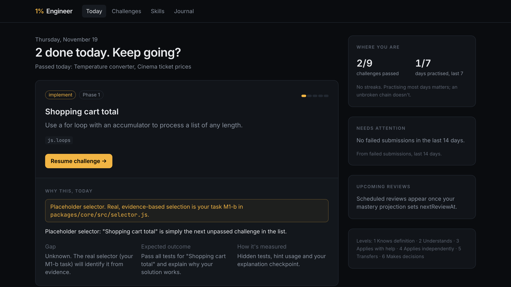
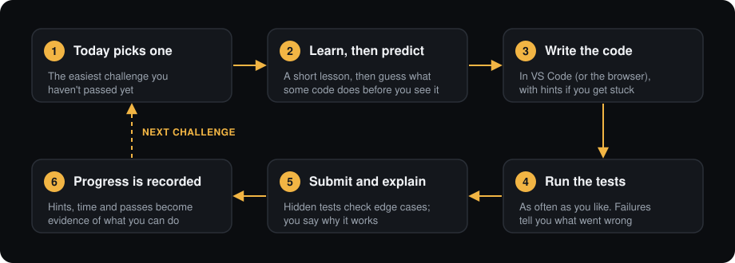
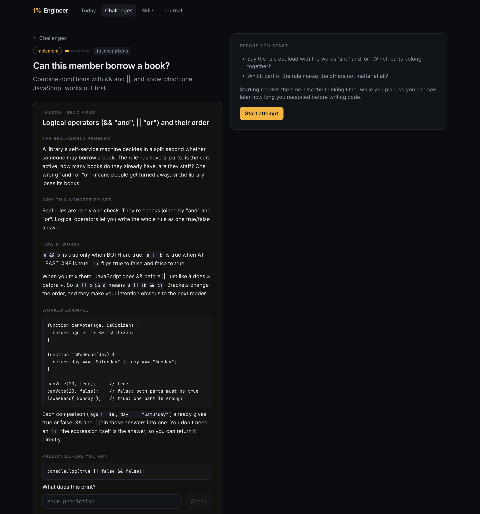
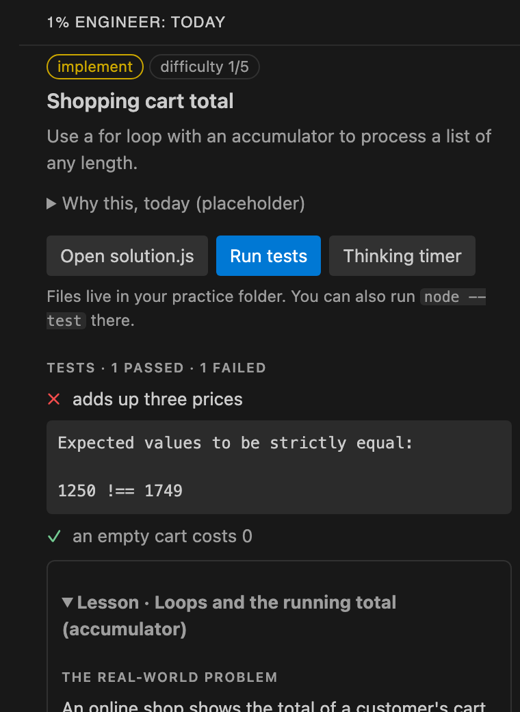
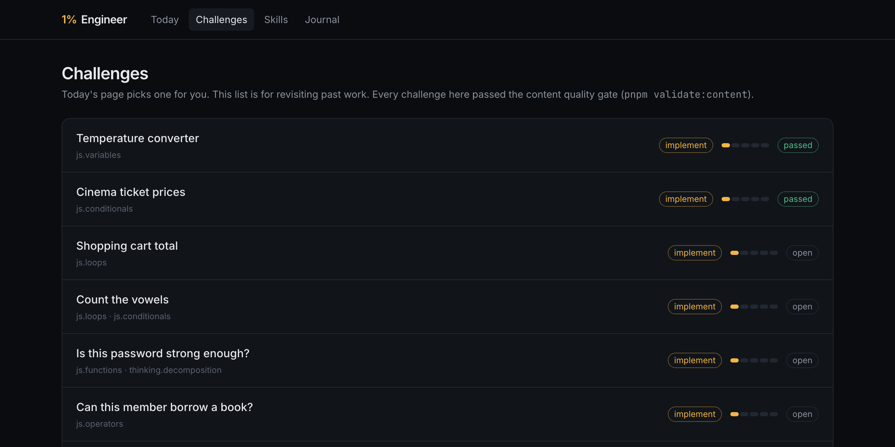
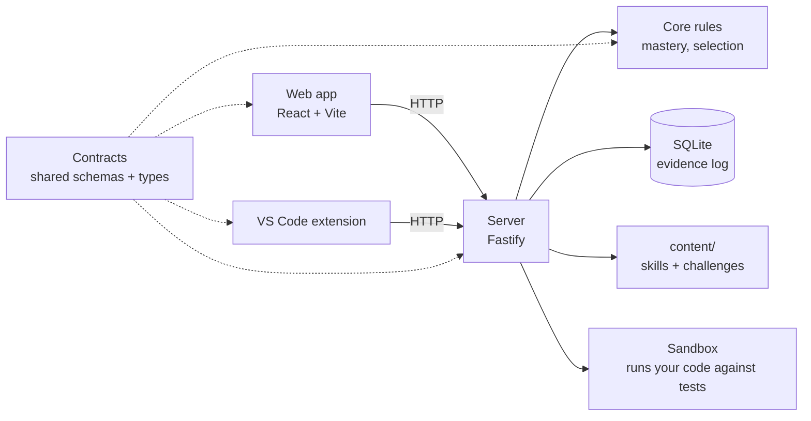

# 1% Engineer

**A personal coding coach that runs on your own computer.**
Short lessons, real-world challenges and honest progress tracking, so you get a little better every day.



---

## What it is

1% Engineer teaches programming by doing. Each challenge starts with a short lesson, asks you to
predict what some code does, then gives you a small real-world problem to solve in your own editor.
Tests tell you straight away if your code works.

It starts with the basics of **JavaScript** and gets harder only when your results show you're ready.
TypeScript comes later, as a level-up.

- **Free and private.** Everything runs on your Mac. No account, no subscription, nothing sent anywhere.
- **No AI needed to use it.** Challenges are written in advance and proven correct before you see them
  ([how](#how-are-the-challenges-made)).
- **Honest.** It records how much help you used, and it never pretends a guess is a measurement.

## How it works



There's no daily limit: pass a challenge and the next one is ready straight away.

## A quick tour

### 1. Learn the idea first

Beginner challenges open with a lesson: the real-world problem, why the concept exists, how it works,
and a worked example. Then you **predict** what a piece of code will print, and only see the answer
after you've committed to a guess.



### 2. Write the code in VS Code

The VS Code extension adds a **1% Engineer** sidebar. It creates the challenge files for you, runs the
tests with one click, and shows exactly which test failed and why.



Prefer the browser? Every challenge also has an editor on its web page.

### 3. Keep going

The challenge list runs from easiest to hardest. Each challenge shows its type, its difficulty
and whether you've passed it.



## Get started

You need a **Mac**, [**Node.js 22.5 or newer**](https://nodejs.org) and [**pnpm**](https://pnpm.io/installation).

**1. Install and start it (once):**

```bash
pnpm install
pnpm autostart:install
```

This builds the app and sets it to start automatically every time you log in.

**2. Open it:** go to **http://127.0.0.1:4100**. That's it, from now on. No commands to run each day.

**3. Add the VS Code extension (recommended):**

```bash
pnpm vscode:install
```

Then open your practice folder (`~/Documents/1pe-practice`) in VS Code and click the
**1% Engineer** icon in the sidebar. More detail: [docs/VSCODE.md](docs/VSCODE.md).

### Doing a challenge

1. Read the lesson and make your prediction.
2. Click **Start challenge**. This creates `solution.js` in your practice folder.
3. Write your code inside the function. Click **Run tests** as often as you like.
4. Stuck? Ask for a **hint**. They start gentle and get more specific.
5. When all tests pass, explain *why* your code works in a few sentences, then **Submit**.
6. Click **Next** to go straight to the next challenge.

## New challenges on demand

With [Claude Code](https://claude.com/claude-code), type:

```
/daily-challenge
```

It reads your progress, decides what you need next, and writes a new challenge for you:

- **Struggled with something?** You get more practice on that skill, in a new real-world setting.
- **Breezing through?** It moves you up a level, but only after 3 passes with little help.
- **Otherwise,** it introduces the next skill you're ready for.

Every new challenge must pass the same quality check as the built-in ones before it appears.
You can also ask for several at once (`/daily-challenge 3`) or a topic (`/daily-challenge js.arrays`).

## Questions

### How are the challenges made?

Each challenge is a folder of files written in advance:

| File | What it is |
|---|---|
| `challenge.yaml` | The lesson, problem, hints and examples |
| `starter.js` | The code you start from |
| `public.test.js` | Tests you can see |
| `hidden.test.js` | Tests you can't see, for edge cases |
| `solution.js` | A reference solution (you can view it, but it's recorded) |
| `wrong/*.js` | Common wrong answers |

A checker (`pnpm validate:content`) proves every challenge is fair before it can be used. The reference
solution must pass every test, the starter must fail, and **every common wrong answer must be caught**
by at least one test.

### Does it use AI? Do I need a subscription?

No. Using the app needs no AI and no subscription. AI is only used, optionally, to *write* new
challenges with `/daily-challenge`, and those still have to pass the checker above.

### Where is my data?

On your computer, in `data/1pe.sqlite`. Nothing leaves your machine. The app only listens on
`127.0.0.1`, so other devices can't reach it.

### What can't it see?

Help you get outside the app, like asking a person, an AI or a search engine. When you submit, it
asks you, and it trusts your answer. Be honest: it only works if the record is true.

## Everyday commands

| Command | What it does |
|---|---|
| `pnpm autostart:status` | Is the app running? Where are the logs? |
| `pnpm autostart:restart` | Restart it, e.g. after adding challenges |
| `pnpm autostart:stop` | Stop it until you next log in |
| `pnpm autostart:start` | Start it again |
| `pnpm autostart:uninstall` | Remove auto-start (your data stays) |
| `pnpm validate:content` | Check every challenge is fair |

<details>
<summary><b>For developers</b>: architecture, principles and project layout</summary>

### Architecture



### Principles

- **Simple rules decide your level.** The rules are plain, tested functions, never an AI.
- **One record, many views.** Skill levels are calculated from your evidence every time, never stored,
  so different parts of the app can't disagree.
- **Every number says where it came from:** `observed`, `manual` or `inferred`.
- **Content is code.** Challenges live in git and must pass `validate:content`.
- **Honest about limits.** What the app can't see, you report yourself.

### Working on the app

To work on the app with live reload, stop the auto-started copy first:

```bash
pnpm autostart:stop
pnpm dev                # server on :4100, web on :5173
```

```bash
pnpm test               # everything
pnpm test:core          # the core rules (15 fail on purpose until you finish tasks M1-a/b)
pnpm typecheck
```

Your build tasks are in [docs/TASKS.md](docs/TASKS.md).

### Layout

| Path | What's there |
|---|---|
| `apps/web` | The web app (Today, Challenges, Skills, Journal) |
| `apps/server` | The API, the sandboxed test runner, the project runner and the database |
| `apps/vscode` | The VS Code extension |
| `packages/contracts` | Shared schemas and types |
| `packages/core` | The rules: `independence.js` (worked example), `mastery.js` and `selector.js` (your tasks) |
| `content/skills` | The map of skills to learn |
| `content/challenges` | One folder per challenge |
| `content/projects` | Build by Learning projects: decisions, steps, behaviour checks, references ([plan](docs/BUILD-BY-LEARNING.md)) |
| `.claude/skills/daily-challenge` | The `/daily-challenge` generator |
| `scripts/autostart.mjs` | Starts the app at login (macOS) |

</details>
